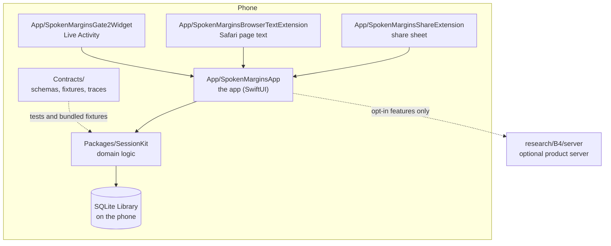

# Architecture

Spoken Margins is a native iPhone and iPad app for listening to articles, PDFs and podcasts and recording Margins (spoken or written notes anchored to the source). It needs iOS or iPadOS 26. This page is the map; the other pages in this folder cover [what stays compatible](compatibility.md) and [what works offline and what leaves the phone](offline-and-privacy.md).

## The app

`App/SpokenMarginsApp/` is the iOS and iPadOS app. It owns the screens, the audio session and the system integrations (Now Playing, the Lock Screen, the Live Activity). It keeps its playback and import logic in one large model, `Gate1AppModel.swift`, and is being split into smaller types; new logic goes into SessionKit instead (see [SessionKit](#sessionkit)).

Three extensions hand things to the app:

- `App/SpokenMarginsShareExtension/` is the share sheet. It accepts a link, text, a PDF or a `.spokenmargins` packet and passes it to the app.
- `App/SpokenMarginsBrowserTextExtension/` is a Safari web extension that sends the text of the page you are reading to the app.
- `App/SpokenMarginsGate2Widget/` is the WidgetKit extension that hosts the Live Activity and its compact controls while you listen. It is not a Home Screen widget.

Code shared between the app and its extensions is in `App/Gate2Shared/` (the command queue, the Live Activity types and the handoff between extension and app), `App/SharedSources/` (PDF text extraction) and `App/SharedResources/` (the page-text script the Safari extension uses). `App/SpokenMarginsWatch/` holds Watch code that the project does not build today.

The Xcode project is generated from `project.yml` with XcodeGen, and both are committed.

## SessionKit

`Packages/SessionKit/` is a Swift package that holds the listening logic and can be built and tested on a Mac without a simulator. It is split into modules so that most of it has no dependence on the app:

| Module | What it holds |
| --- | --- |
| `SessionKit` | sessions, items, Margins, anchors, source resolution, narration planning |
| `SessionKitPersistence` | the SQLite store and its migrations |
| `SessionKitSharing` | exporting and importing `.spokenmargins` packets |
| `SessionKitAudio` | playback adapters and podcast anchor evidence |
| `SessionKitFeeds`, `SessionKitEPUB` | podcast and article feeds, followed sources, EPUB reading |
| `SessionKitSpeechFrontEnd`, `SessionKitSupertonic`, `SessionKitPocket` | the text front end and the neural voice runtimes |
| `SessionKitAI` | descriptions of the optional AI providers |

Some of these build on Linux as well as macOS. The list is at the bottom of `Packages/SessionKit/Package.swift`, and [the package README](../../Packages/SessionKit/README.md) says what each module does and how its tests run. The package also builds three Mac-only developer tools (`coop-packet`, `speech-bench`, `phone-plan`) that the app never links.

## Contracts

`Contracts/` holds the formats the app and its tests agree on: JSON schemas (`Contracts/schemas/`), example files (`Contracts/fixtures/`), recorded session traces (`Contracts/traces/`) and design notes (`Contracts/docs/`). The app bundles the fixtures and traces; SessionKit's tests read the whole folder. A change to a format changes a schema and a fixture together, and a validator (`scripts/validate-contracts.py`) checks the pair.

## Where data lives

The Library is one SQLite file in the app's Application Support folder, written through `SessionKitPersistence`. Recordings and downloaded audio are files beside it. Packets are zip files with a `.spokenmargins` extension, read and written by `SessionKitSharing`. See [compatibility](compatibility.md) for the rules that keep both readable across builds.

## The optional product server

`research/B4/server/` is a small Go server that backs the features that need one: share links, community Listening Maps and the app's remote configuration. The app works without it. Core listening, import, recording and packet files are all local, and each server feature is opt-in on the phone and off on the server until it is switched on; [offline and privacy](offline-and-privacy.md) lists exactly which features reach it and what they send. Its deploy files are in `research/B4/deploy/`, and `Site/` holds the static pages and the starter podcast catalog it serves.

## Tests

Host tests (`scripts/verify-tests.py --plan fast`) run SessionKit, the contract validators and the browser-code suites without a simulator. App-hosted tests and journeys run on a Mac with Xcode. [`docs/testing.md`](../testing.md) has the details.
