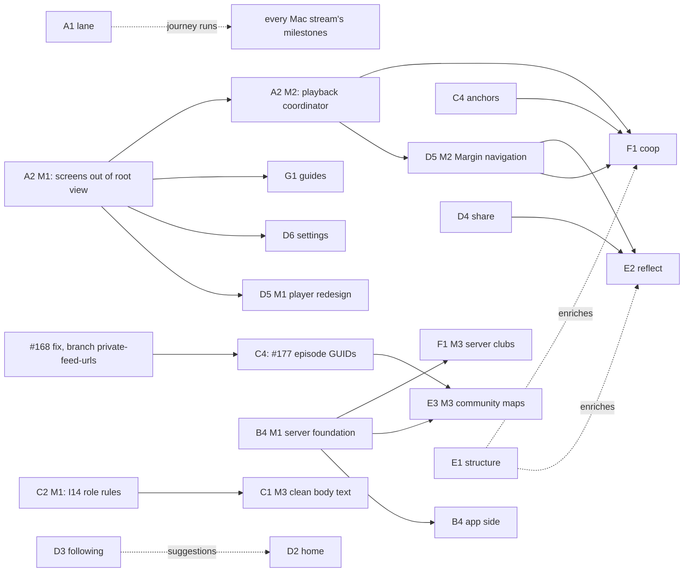

# Parallel workstreams

Planned 2026-09-28 from the owner's voice notes. This folder lets several agents work at once without stepping on each other.

- **This page** is the map: the streams, what gates what, the order to start them, and how work merges.
- **[streams/](streams/)** holds one brief per stream. Each brief states the outcome and how to tell when it's done. It doesn't say how to build it; the agent decides that.
- **[interfaces.md](interfaces.md)** is where streams meet. Each seam has one owner and a short list of rules that must hold.
- **[test-lane.md](test-lane.md)** covers sharing the one Mac: test tiers (so small changes don't trigger hours of regression) and how any stream gets a simulator run and a report back.
- **[kickoff.md](kickoff.md)** is the prompt to start a stream, plus the Claude Code features that make unattended work reliable.

Status never lives in these files. It lives in GitHub: one tracking issue per stream (label `stream:<id>`), plus that stream's PRs. A brief changes only when the goal changes.

## Reading a brief's "Done when"

A milestone's "Done when" is met through PRs, and a PR is done when it's armed: `automerge` on, plus a `/lane T3` request when the diff needs one (`AGENTS.md`, [lane-request skill](../../.claude/skills/lane-request/SKILL.md)). This rule covers every brief, so the briefs themselves don't repeat it.

- **Items the agent can show** (a test that fails without the change, a measured number, a fixture, a tap count, a screenshot) are shown in the PR description before arming.
- **Lane items** ("T2 green", "T3 green", "Lane T3 is green") are met by arming the PR. The runner merges only on PASS, so the thread doesn't wait for the report.
- **"Lane T4" items and named journeys** run in the integration run on `main`'s merged tip ([test-lane.md](test-lane.md), Three test levels). The PR names them so that run covers them.
- **Items marked (owner) or (Mac)** stay out, as before.

The thread that armed the PR moves on to its next issue and doesn't chase the lane. A lane FAIL on the PR's own code goes to whoever is free, through the project's hourly dispatcher. A runner fault gets one more run (a new `/lane T3` comment with the same `tests:` line plus `lane:queued` for an INCONCLUSIVE T3, or `automerge` removed and re-added for a host-test or build fault), and becomes an issue labelled `ready` and `regression` only if it fails the same way again.

## Ground rules

These keep the rules in `AGENTS.md` and add what's needed for parallel work. The September 23–24 co-op attempt failed on the things listed here, so they aren't optional (see `docs/repo-review-2026-09-24.md`).

1. **One agent per stream, one change at a time within it.** Parallelism comes from separate streams, not from manager, implementer and auditor agents on one stream. One owner per change, and one writer per set of files. Sub-agents and workflows are fine for exploration, reviews, critics, and tests in their own worktrees.
2. **Streams meet only at seams.** If you need something from another stream, build against its published seam or a stub of it. If the seam doesn't exist yet, comment on the owner stream's tracking issue. Don't reach into its files.
3. **No handoff, audit or status documents.** Commit messages, PR descriptions and lane reports are the record.
4. **Don't grow `Gate1AppModel` or `Gate1RootView`.** New logic goes in focused types, in SessionKit when it can be host-tested. Keep edits to either file to thin call sites.
5. **Test at the lowest tier that covers the change** ([test-lane.md](test-lane.md)). Only the lane boots simulators.
6. **Keep packets and databases backward-compatible.** The last shipped build's packet reader rejects unknown keys, so no packet field is "just additive" (interfaces.md, I10). Never touch the owner's Library data.
7. **Nothing reaches testers without the owner.** Streams merge into `main`, and the owner decides when a commit on `main` becomes a TestFlight build.

## The streams

"Where" is where the work can happen. Cloud streams run in Claude Code on the web and need nothing from the Mac. Mac streams need Xcode. "Both" means research or server work runs in the cloud, then a Mac milestone wires it into the app. "Waits for" is per milestone; a stream starts as soon as its first milestone is free.

| ID | Stream | Outcome in one line | Where | Wave | Waits for |
| --- | --- | --- | --- | --- | --- |
| A1 | [lane](streams/A1-lane.md) | Any stream can get a build, tests or a journey run on the Mac and a report back, without the owner | Mac | 0 | — |
| A2 | [seams](streams/A2-seams.md) | The remaining screens leave the root view, and one coordinator owns playback | Mac | 0 | M2: M1 |
| A3 | [triage](streams/A3-triage.md) | The 106 open issues are sorted into streams, duplicates and done-but-open | Cloud | 0 | M2: owner approval |
| B1 | [onboard](streams/B1-onboard.md) | A new listener follows five podcasts in under a minute without leaving the app | Both | 0→1 | — |
| B2 | [substack](streams/B2-substack.md) | Any Substack link reliably offers Follow; paid subscribers can listen to paid posts | Both | 0 | M2 shipping: owner call |
| B3 | [youtube](streams/B3-youtube.md) | Pasting a YouTube podcast link finds the podcast episode, or says honestly that it can't | Both | 0→1 | M2: I1 (B1) |
| B4 | [bridge](streams/B4-bridge.md) | Sites without RSS can be followed like any feed, through a small privacy-preserving server | Both | 0→2 | — |
| C1 | [pdf](streams/C1-pdf.md) | Scientific PDFs from many publishers read cleanly, and figures and tables can be seen | Both | 0→1 | M3: I14 role rules (C2 M1) |
| C2 | [voice](streams/C2-voice.md) | Narration never degrades silently, and a bundled fallback voice beats Samantha at ≥2× real time | Both | 0→1 | — |
| C3 | [live-activity](streams/C3-live-activity.md) | The Live Activity removes itself when Spoken Margins is no longer playing | Mac | 0 | — |
| C4 | anchors | Shared podcast Margins land in the right place ([existing plan](../podcast-anchor-plan.md)). Slices 3 and 6 are on `play-this-moment`. Also owns #177 (episode GUIDs, after #168) | Mac | ongoing | #177: `private-feed-urls` merged |
| D2 | [home](streams/D2-home.md) | A Home screen a listener could live in | Mac | 1 | M2: D3 M2 |
| D3 | [following](streams/D3-following.md) | Following ranks and filters new items transparently, and the listener can tune it with their own AI | Both | 1 | M2: logged signals from a shipped build |
| D4 | [share](streams/D4-share.md) | Sharing a Margin or exporting notes takes two taps | Mac | 0→1 | — |
| D5 | [player](streams/D5-player.md) | A redesigned playback screen, with Skim to the next Margin and "Play this moment" | Mac | 2 | M1: A2 M1. M2: A2 M2 |
| D6 | [settings](streams/D6-settings.md) | Settings a tester isn't intimidated by, with diagnostics tucked away rather than removed | Mac | 1 | A2 M1 |
| E1 | [structure](streams/E1-structure.md) | Every Margin gets an on-device structured form: claim, question, what it refers to | Both | 0→2 | M1: owner's Margin export. M4: I12 (D4 M2) |
| E2 | [reflect](streams/E2-reflect.md) | A weekly review turns a week of Margins into a note worth keeping | Mac | 2 | M1: D4 M2. M2: A2 M2, D5 M2 |
| E3 | [maps](streams/E3-maps.md) | Listeners without on-device AI still get listening maps, shared through a community server | Both | 1→3 | M2: B4 M1. M3: B4 M1, #177 (C4), owner route call |
| F1 | [coop](streams/F1-coop.md) | A group can listen to one item, hear each other's new Margins and reply | Mac | 2→3 | M1: A2 M2, C4. M2: D5 M2. M3: B4 M1 |
| G1 | [guides](streams/G1-guides.md) | How-to guides with screenshots and GIFs, regenerated by one command when the app changes | Mac | 2 | I15 (A2 M1), A1 M3 |
| G2 | [growth](streams/G2-growth.md) | A tested view of who the early adopters are and a repeatable inbound-content method | Cloud | 0 | — |

## What gates what

The gates, in plain words:

- **The root-view split (A2 M1).** Library, Following, Margins, Item and the tab shell already have their own files. Playback, Settings, Export, Batch Export and Help still live inside the 5,500-line `Gate1RootView.swift`, alongside about 1,200 lines of dead views. A2 M1 moves them out and adds stable UI identifiers. It gates the player redesign, Settings and the guides. Other UI streams can start without it; their shared risk is `Gate1AppModel`, covered by ground rule 4.
- **The playback coordinator (A2 M2)** comes before any *new* feature that interleaves Margin audio with source audio: Skim to the next Margin, the weekly review's audio mode, and co-op. This is the fix the repo review recommended after four playback state machines collided. "Play this moment" (#158, #159) already exists on `play-this-moment` as `MarginMomentConductor`; the coordinator absorbs it rather than adding another.
- **The server foundation (B4 M1)** comes before any app feature that calls a server. It runs on the owner's VPS, which is approved (`AGENTS.md`); deploying to it is the owner's step.
- **The #168 → #177 chain.** Packets could leak private feed URLs (#168); the fix is on `private-feed-urls` (`ShareableLinkPolicy`). Storing episode GUIDs (#177) builds on it, and community maps need GUIDs to find an episode.
- **Rights (owner call)** decide whether the community server may store transcripts or only derived maps (#14, #173).

## Start now from the phone (no laptop)

These streams can start in Claude Code on the web today and do real work before the Mac is online.

- **Where they branch from:** `ws/<id>` from `origin/next` if it exists, otherwise from `origin/claude/project-planning-voice-notes-neoatx`, the branch holding this plan. They merge `next` in once it exists.
- **Where the work goes:** code, test sets and fixtures under `research/<id>/`, so no two streams touch the same files. Findings go on the stream's tracking issue.
- **When they stop:** at the first step marked **(Mac)** or **(owner)**. The agent posts what's waiting and exactly how to run it, then stops. Nothing here needs the simulator.

| Stream | What it can finish without the laptop | Waits for the laptop or owner |
| --- | --- | --- |
| A3 triage | M1: the full triage table | M2: owner approval |
| G2 growth | M1–M3 | — |
| C1 pdf | M1: corpus manifest, scorer, and a baseline using a reference parser | (Mac) running the app's own extractor over the corpus |
| C2 voice | M2 research: candidates, licenses, Linux speed numbers, and a blind listening page with audio samples the owner can play on the phone | (Mac) Mac benchmark; (owner) phone benchmark |
| E1 structure | M1: taxonomy, evaluation set, deterministic baseline (spaCy is fine for research, see brief) | (owner) the Margin export, attached to the session |
| B3 youtube | M1: test set and matcher | `itunes.apple.com` allowed in the cloud environment's network settings |
| B1 onboard | M1's catalog half: the top-podcast snapshot by subject and the remote catalog format | (Mac) the drawer itself |
| B2 substack | M2 research: what paid access Substack offers, and the risks | (Mac) M1, the Follow fix |
| B4 bridge | M1 design note and a server skeleton with tests | (owner) deploying to the VPS |

## Waves

Waves are an order, not dates. A stream starts when its gates open. It doesn't wait for the rest of its wave.

**Wave 0: start now.**

- *Mac:* A1 `lane`, A2 `seams`, and the Build 30 quick wins below. C4 `anchors` continues.
- *Cloud:* A3 `triage`, G2 `growth`, B4 `bridge` M1 design, and the research halves of:
  - C1 `pdf` (corpus and scoring);
  - C2 `voice` (fallback voice candidates);
  - B3 `youtube` (matching method and test set);
  - E1 `structure` (taxonomy and baseline).

**First testable build (Build 30).** Cut it as soon as these pass T5 in the lane. Don't hold it for anything else.

- **Already written, on branches (merge into `next` first):**
  - `play-this-moment`: stream source context (#156); tapping a shared Margin plays its moment (#158); "Play this moment" plays the Margin itself (#159); stalled-clock diagnostics (#166). Verified on the simulator; needs the owner's J5 check.
  - `private-feed-urls`: private feed links kept out of packets and exports (#168). This is D4 M0.
- **Wave 0 quick wins:**
  - C3 M1 (the Live Activity cleans itself up).
  - C2 M1 (#183: power state no longer silently switches voices).
  - B2 M1 (Follow for every Substack link).
  - B1 M1 (the first-run drawer).
- The fixes already on `main` awaiting the owner's device check (label `status: needs-human-validation`).

The reach pass (#141, #145–#149, #151) moves into B1, D3, D4 and D5.

**Wave 1: as gates open.** B1 M2–M3 (search, OPML, refresh), D2 `home`, D3 `following`, D4 M1–M2, D6 `settings`, and the app milestones of C1 `pdf`, C2 `voice` and B3 `youtube`. E3 `maps` M1 (more on-device maps).

**Wave 2: once A2 M2 lands.** D5 `player`, F1 `coop` M1–M2 (serverless groups), E2 `reflect`, E1 `structure` in the app, B4 `bridge` app side, G1 `guides`.

**Wave 3: servers for people.** E3 `maps` community sharing, F1 `coop` server-backed groups and large-club summaries.

## How many at once

- **Mac:** no fixed number of sessions. Memory and disk are the limits: start Mac work only while memory pressure is normal and free disk is at least 10 GB plus 4 GB for each build that's running. The pinned Mac status issue shows both.
  - Builds are shared: **one** Mac-wide semaphore allows two `xcodebuild` runs at a time (one while a simulator job runs), shared by stream sessions and the lane. Simulators only through the lane.
  - Most work runs in the cloud; the Mac's lane runner builds it on request.
  - Wave 0 slots, in order:
    1. A1 `lane`. Its M1 lands before the other slots start, so they get the guard hook and build wrapper. Once M3 is done, this slot becomes the Test Desk.
    2. A2 `seams`.
    3. The Build 30 quick wins, one after another in one session: C3 M1 → C2 M1 → B2 M1 → B1 M1.
  - C4 `anchors` takes the next free slot. If the owner wants anchors to keep priority, it takes slot 3 and the quick wins wait.
- **Cloud:** no practical limit beyond attention. Six to eight at once is a reasonable start: every Wave 0 cloud stream.
- **Owner attention** is the real limit. Streams stop for the owner only under the reversible-decision rule in [kickoff.md](kickoff.md) (owner data, packets and databases, money, anything public, `main` and releases, taste), for owner-only checks, and for FAIL reports on gate streams ([test-lane.md](test-lane.md)). The owner's Claude Code project batches the rest into its daily routine's report ([kickoff.md](kickoff.md#the-lead-session) says who does what).

## Branches and merging

- `main` is the integration branch (the trunk, `SM_TRUNK=main`, since 2026-10-20; before that it was `next`, now frozen). Every stream branches `ws/<id>-…` from `main`, one branch per PR, and opens PRs back into `main`.
- A PR merges into `main` when its tier's lane report is green. The lane runner merges armed `automerge` PRs itself. Audio, persistence, packet and lane diffs wait for a clean Claude (or legacy Codex) audit of their head commit, then merge the same way.
- GitHub closes the issue named by "Closes #N" when a PR merges into the default branch (`main`). Before 2026-10-20 PRs merged into `next`, so issues closed by those PRs stayed open. The hourly dispatcher then removes `in-progress` and names the PR. What happens next depends on whether the owner could notice the change on the phone (owner, 2026-10-11):
  - **Something the owner would see or hear** (a listener-facing bug fix or feature): pick who checks it (owner, 2026-10-15, replacing "when unsure, add the label" below for these):
    - **`agent-verify`**: an agent can show it working with a host test, a real file or Diagnostics. Never on his plans.
    - **`validate-by-use`**: he meets it in ordinary listening. Add an "Owner check: none" comment so it stays off his plans. Once the fix is merged, move the issue to the next milestone so it doesn't block a release, and close it when his use (with no complaint) or Diagnostics show it working.
    - **`status: needs-human-validation`**: only for checks that need his ears, his hands on the phone, or his taste (audible content, Bluetooth, the Lock Screen, background behaviour, design).
    - When unsure among these, choose `agent-verify`.
  - **Internal work** (a model-split code move, a test-honesty or flaky-test fix, a lane, pipeline or ops fix, hardening with no visible change): close it with `sm-gh close-issue <n> --pr <merged pr>`. The owner's use of the milestone candidate covers it; reopen if that build regresses.
  - When unsure whether a change is internal or listener-facing, treat it as listener-facing.
- `python3 scripts/sm_project_sync.py --apply` keeps project 6 in line (#1621). It runs on the Mac, from the Claude Mac worker's existing 10-minute tick, at most once an hour, and the worker syncs its own issue's card after each claim and stop note (`ops/claude/README.md`). The hourly dispatch in the cloud can't run it: its token gets a 403 from the user project's API. A thread on the Mac may run it with `--issue <n>` after a claim or release; the hourly pass repairs what hooks miss. This is deterministic GitHub bookkeeping, with no model, builds, new schedule or worker. Dry-run is the default (`--dry-run` is explicit); it prints proposed changes, reasons, API calls, writes, unknowns and elapsed seconds as JSON. Applying twice with unchanged evidence writes nothing. Every changed item's Status and Check health are read back before reporting success.
  - Status precedence: closed issues are Done under the existing completion rules; open implementation PRs are Checking (draft-only work is In Progress); explicit pending phone-validation labels are Needs your check; explicit holds and Later/Co-op Experience are Todo; a merged listener-facing fix without recorded acceptance is Needs your check; a fresh claim is In Progress; released or quiet claims are Todo. An open internal merged fix stays Checking for dispatch to close under the existing rules. Reopened/reclaimed issues can begin implementation again after a prior merge.
  - **Check health** is a separate text field: Waiting on checks/review versus Needs attention, with the head's failures, conflicts, audit blockers, runner holds or owner merge tap named. Old-head PASS reports never become head passes. The script reuses `sm_status.py`'s live reader. Routine lane, audit, phone and bot comments do not keep an implementer active. `found-on-phone` alone identifies a reported bug, not a completed fix ready for acceptance. A claim has a six-hour activity window; the script changes its display, never releases the label itself.
  - Project 6 must have Status options `Todo`, `In Progress`, `Checking`, `Needs your check` and `Done`. Missing options fail safely with an unknown; the script does not replace the dropdown or its existing values. On the first applying run that needs it, the script creates the Check health text field. Area, other fields, existing views, drafts, other repositories, issue closure and all labels (including validation, found-on-phone and priority) are preserved. The existing views can show Check health beside Status.
  - Cost, measured on 2026-10-15: the first applying run on the live board made 142 changes (184 writes, all read back) in 398 calls and 263 s; the next run changed nothing, with 0 writes, 69 calls and 44 s. The worker's log keeps each run's changes, unknowns, calls, writes and seconds. Repeated writes on a run with no new evidence, or the calls climbing, mean the derivation is flipping or scanning twice. Authentication needs repository read and project write permissions (the Mac's `gh` token has the `project` scope).
- Streams merge `main` into their branch at least daily, and before any lane request, so reports test what will actually integrate.
- Merge order when PRs conflict: gate streams (A2 first), then the older PR.
- A TestFlight candidate is a commit on `main` that passed T5. Releasing still follows "Releasing a build" in `AGENTS.md`, by the owner's decision.

## Owner setup (one-time, about 30 minutes at the Mac)

0. **Merge this branch into `main`.** It updates `AGENTS.md` so the rules agents read first match this plan: one agent per stream, branching from `next`, and simulator plans through the lane. Until then, agents following `AGENTS.md` would work one at a time from `main`.
1. Create `next` from `main`, then merge in `play-this-moment` and `private-feed-urls`. Both edit the Build 30 line in `AGENTS.md`; keep this plan's version. Push it. Keep the Mac's main checkout on `next`, and set `"worktree": {"baseRef": "head"}` in the Mac's user settings (`~/.claude/settings.json`), so worktrees spawned from the phone start from `next`. An agent can do the branch and merges if you say so.
2. Create the `stream:<id>` labels and one tracking issue per stream linking its brief. An agent can do this; say the word.
3. Cloud network access: this session's network policy refused `itunes.apple.com`, `podcastindex.org` and `github.com` web pages. The B1, B3 and C2 research needs them. Add them in the cloud environment's settings (Network access), or pick a broader access level.
4. On the Mac: start A1 `lane` first. Its M1 installs the simulator guard in the Mac's user-level settings, so it applies to every session, whatever branch it started on.

## Decisions the owner owns

The briefs flag these where they come up. Parallel streams, the lane runner merging into `next`, hosting on the VPS and the design direction are settled (the owner's standing calls, in the private overlay to `AGENTS.md`).

| Decision | Blocks | Recommendation |
| --- | --- | --- |
| Community server stores transcripts, or only derived maps | E3 M3 | Maps only at first. Transcripts stay on devices until the rights question (#14) is settled |
| Whether the app may hold a Substack sign-in for paid posts | B2 M2 | Decide after B2's research. Nothing handling credentials ships before then |
