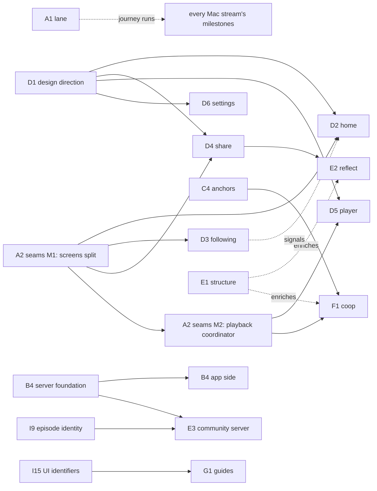

# Parallel workstreams

Planned 2026-09-28 from the owner's voice notes. This folder lets several agents work at once without stepping on each other.

- **This page** is the map: the streams, what gates what, the order to start them, and how work merges.
- **[streams/](streams/)** holds one brief per stream. Each brief states the outcome and how to tell when it's done. It doesn't say how to build it; the agent decides that.
- **[interfaces.md](interfaces.md)** is where streams meet. Each seam has one owner and a short list of rules that must hold.
- **[test-lane.md](test-lane.md)** covers sharing the one Mac: test tiers (so small changes don't trigger hours of regression) and how any stream gets a simulator run and a report back.
- **[kickoff.md](kickoff.md)** is the prompt to start a stream, plus the Claude Code features that make unattended work reliable.

Status never lives in these files. It lives in GitHub: one tracking issue per stream (label `stream:<id>`), plus that stream's PRs. A brief changes only when the goal changes.

## Ground rules

These keep the rules in `AGENTS.md` and add what's needed for parallel work. The September 23–24 co-op attempt failed on the things listed here, so they aren't optional (see `docs/repo-review-2026-09-24.md`).

1. **One agent per stream, one change at a time within it.** Parallelism comes from separate streams, not from manager, implementer and auditor agents on one stream. Sub-agents are fine for read-only research, and for a fresh-context review of a diff before a milestone.
2. **Streams meet only at seams.** If you need something from another stream, build against its published seam or a stub of it. If the seam doesn't exist yet, comment on the owner stream's tracking issue. Don't reach into its files.
3. **No handoff, audit or status documents.** Commit messages, PR descriptions and lane reports are the record.
4. **Don't grow `Gate1AppModel` or `Gate1RootView`.** New logic goes in focused types, in SessionKit when it can be host-tested. Until A2 `seams` lands, a stream that must touch either file keeps the edit to a thin call site.
5. **Test at the lowest tier that covers the change** ([test-lane.md](test-lane.md)). Only the lane boots simulators.
6. **Keep packets and databases backward-compatible.** Never touch the owner's Library data.
7. **Nothing reaches `main` without the owner.** Streams merge into `next`, and the owner decides when `next` becomes a TestFlight build.

## The streams

"Where" is where the work can happen. Cloud streams run in Claude Code on the web and need nothing from the Mac. Mac streams need Xcode. "Both" means research or server work runs in the cloud, then a Mac milestone wires it into the app.

| ID | Stream | Outcome in one line | Where | Wave | Waits for |
| --- | --- | --- | --- | --- | --- |
| A1 | [lane](streams/A1-lane.md) | Any stream can get a build, tests or a journey run on the Mac and a report back, without the owner | Mac | 0 | — |
| A2 | [seams](streams/A2-seams.md) | The app is split so UI streams edit different files, and one coordinator owns playback | Mac | 0 | — (M2 after M1) |
| A3 | [triage](streams/A3-triage.md) | The 106 open issues are sorted into streams, duplicates and done-but-open | Cloud | 0 | — |
| B1 | [onboard](streams/B1-onboard.md) | A new listener follows five podcasts in under a minute without leaving the app | Both | 0→1 | I1/I2 published by itself |
| B2 | [substack](streams/B2-substack.md) | Any Substack link reliably offers Follow; paid subscribers can listen to paid posts | Both | 0 | owner call on paid access |
| B3 | [youtube](streams/B3-youtube.md) | Pasting a YouTube podcast link finds the podcast episode, or says honestly that it can't | Both | 0→1 | I1 |
| B4 | [bridge](streams/B4-bridge.md) | Sites without RSS can be followed like any feed, through a small privacy-preserving server | Both | 0→2 | owner hosting and budget call |
| C1 | [pdf](streams/C1-pdf.md) | Scientific PDFs from many publishers read cleanly, and figures and tables can be seen | Both | 0→1 | — |
| C2 | [voice](streams/C2-voice.md) | Narration never degrades silently, and a bundled fallback voice beats Samantha at ≥2× real time | Both | 0→1 | — |
| C3 | [live-activity](streams/C3-live-activity.md) | The Live Activity removes itself when Spoken Margins is no longer playing | Mac | 0 | — |
| C4 | anchors | Shared podcast Margins land in the right place ([existing plan](../podcast-anchor-plan.md)) | Mac | ongoing | — |
| D1 | [design](streams/D1-design.md) | The owner picks a navigation and visual direction from clickable prototypes, with tap budgets | Cloud | 0 | — |
| D2 | [home](streams/D2-home.md) | A Home screen a listener could live in | Mac | 1 | A2 M1, D1 |
| D3 | [following](streams/D3-following.md) | Following ranks and filters new items transparently, and the listener can tune it with their own AI | Both | 1 | A2 M1 |
| D4 | [share](streams/D4-share.md) | Sharing a Margin or exporting notes takes two taps | Mac | 1 | A2 M1, D1 |
| D5 | [player](streams/D5-player.md) | A redesigned playback screen, with Skim to the next Margin and "Play this moment" | Mac | 2 | A2 M2, D1 |
| D6 | [settings](streams/D6-settings.md) | Settings a tester isn't intimidated by, with diagnostics tucked away rather than removed | Mac | 1 | D1 |
| E1 | [structure](streams/E1-structure.md) | Every Margin gets an on-device structured form: claim, question, what it refers to | Both | 0→2 | — |
| E2 | [reflect](streams/E2-reflect.md) | A weekly review turns a week of Margins into a note worth keeping | Mac | 2 | D4 (I12); E1 helps but isn't required |
| E3 | [maps](streams/E3-maps.md) | Listeners without on-device AI still get listening maps, shared through a community server | Both | 1→3 | B4 M1, I9, owner rights call |
| F1 | [coop](streams/F1-coop.md) | A group can listen to one item, hear each other's new Margins and reply | Mac | 2→3 | A2 M2, C4 |
| G1 | [guides](streams/G1-guides.md) | How-to guides with screenshots and GIFs, regenerated by one command when the app changes | Mac | 2 | I15 |
| G2 | [growth](streams/G2-growth.md) | A tested view of who the early adopters are and a repeatable inbound-content method | Cloud | 0 | — |

## What gates what

The gates, in plain words:

- **The split (A2 M1)** comes first, because four UI streams would otherwise all edit the same 5,500-line view and 16,000-line model. A2 can start with mechanical extraction before the design direction is chosen.
- **The design direction (D1)** comes from the owner picking between prototypes. It gates the look of Home, Share, Player and Settings, not their plumbing, so those streams can build data and logic first.
- **The playback coordinator (A2 M2)** comes before anything that interleaves Margin audio with source audio: the new player, "Play this moment", and co-op. This is the fix the repo review recommended after four playback state machines collided.
- **The server foundation (B4 M1)** comes before any app feature that calls a server. It needs owner decisions on hosting, cost ceiling and privacy wording.
- **Rights (owner call)** decide whether the community server may store transcripts or only derived maps (#14, #173).

## Waves

Waves are an order, not dates. A stream starts when its gates open. It doesn't wait for the rest of its wave.

**Wave 0: start now.** These need nothing from anyone.

- *Mac:* A1 `lane`, A2 `seams` M1, and the quick-win milestones of C3 `live-activity`, C2 `voice` (#183), B2 `substack` (the Follow button). C4 `anchors` continues.
- *Cloud:* A3 `triage`, D1 `design`, G2 `growth`, the research halves of C1 `pdf` (corpus and scoring), C2 `voice` (fallback voice candidates), B3 `youtube` (matching method and test set), B4 `bridge` (server design and foundation) and E1 `structure` (labeled set and deterministic baseline).

**First testable build (Build 30).** The quick wins above, plus B1 `onboard` M1 (the first-run drawer) and the Build 30 candidates already in `AGENTS.md`. Cut it as soon as those pass T5 in the lane. Don't hold it for anything in Wave 1.

**Wave 1: once A2 M1 and D1 land.** B1 `onboard` (search, OPML), D2 `home`, D3 `following`, D4 `share`, D6 `settings`, and the app milestones of C1 `pdf`, C2 `voice` and B3 `youtube`. E3 `maps` M1 (the app's own on-device transcripts → maps path).

**Wave 2: once A2 M2 lands.** D5 `player`, F1 `coop` M1–M2 (serverless groups), E2 `reflect`, E1 `structure` in the app, B4 `bridge` app side, G1 `guides`.

**Wave 3: servers for people.** E3 `maps` community sharing, F1 `coop` server-backed groups and large-club summaries.

## How many at once

- **Mac:** at most **three** stream sessions writing code, plus the Test Desk. Builds are the constraint: two `xcodebuild` runs at a time through the lane's semaphore, and simulators only through the lane. If builds queue for more than about 15 minutes, drop to two streams.
  - Wave 0 slots, in order:
    1. A1 `lane`. Its M1 lands before the other slots start, so they get the guard hook and build wrapper. Once M3 is done, this slot becomes the Test Desk.
    2. A2 `seams`.
    3. The Build 30 quick wins, one after another in one session: C3 → C2 M1 → B2 M1 → B1 M1.
  - C4 `anchors` takes the next free slot. If the owner wants anchors to keep priority, it takes slot 3 and the quick wins wait.
  - Wave 0 UI changes (B1 M1, B2 M1) go in new files with thin call sites, and merge `next` in after A2 M1 lands.
- **Cloud:** no practical limit beyond attention. Six to eight at once is a reasonable start: every Wave 0 cloud stream.
- **Owner attention** is the real limit. Streams ping the owner only for decisions and FAIL reports on gate streams ([test-lane.md](test-lane.md)).

## Branches and merging

- `next` is the integration branch, created from `main`. Every stream branches `ws/<id>` from `next` and opens PRs back into `next`.
- A PR merges into `next` when its tier's lane report is green. The owner taps merge from the phone. If that becomes the bottleneck, the owner can let T1/T2-only PRs merge themselves.
- Streams merge `next` into their branch at least daily, and before any lane request, so reports test what will actually integrate.
- Merge order when PRs conflict: gate streams (A2 first), then the older PR.
- A TestFlight candidate is a commit on `next` that passed T5. Releasing still follows "Releasing a build" in `AGENTS.md`. `main` is fast-forwarded only at release, by the owner's decision.

## Owner setup (one-time, about 30 minutes at the Mac)

1. Create `next` from `main` and push it.
2. Create the `stream:<id>` labels and one tracking issue per stream linking its brief. An agent can do this; say the word.
3. Cloud network access: this session's network policy refused `itunes.apple.com`, `podcastindex.org` and `github.com` web pages. The B1, B3 and C2 research needs them. Add them in the cloud environment's settings (Network access), or pick a broader access level.
4. On the Mac: start A1 `lane` first. Its first milestone is the worktree bootstrap and the simulator guard hook every other Mac stream uses.

## Decisions the owner owns

The briefs flag these where they come up. None of them blocks Wave 0.

| Decision | Blocks | Recommendation |
| --- | --- | --- |
| Allow one agent per stream in parallel (this plan) instead of "one agent at a time" | everything | Yes. Update the first "How to work" line in `AGENTS.md` to "one agent per stream" |
| Who merges into `next` | throughput | Owner taps merge at first; allow self-merge for T1/T2 once trust builds |
| Server hosting and monthly cost ceiling | B4 M1, E3, F1 server | Static hosting for manifests plus one small serverless function, with a hard budget alert |
| Community server stores transcripts, or only derived maps | E3 M3 | Maps only at first. Transcripts stay on devices until the rights question (#14) is settled |
| Whether the app may hold a Substack sign-in for paid posts | B2 M2 | Decide after B2's research. Nothing handling credentials ships before then |
| Design direction | D2, D4, D5, D6 look and feel | Decided from D1's prototypes |
